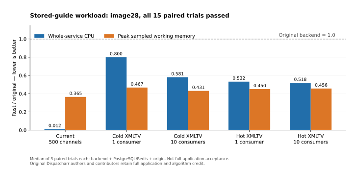

# Stored-guide resource comparison

Original Dispatcharr authors and contributors retain full application and algorithm credit. The existing React frontend is preserved.

Image28 passed all 15 paired trials under the frozen Source plan `69599ae7ebdf3ebb9e5c331a0321a8f8a59823eee48a6ec61e0a9f8e1c5a5cd0`. The complete stored Current-programme/XMLTV matrix is accepted within the scope below. This does not accept a complete migration milestone or the whole application.

## Reproducible scope

Candidate manifest: `artifacts/rust/candidate-build-bulk-reply-image28-1/build.json`.

- Image: `sha256:0d0a95bc32fa9bbfabf81ad9062a3f7e456de39229e1dfe1cc12b92a9a10b996`.
- Source tree: `2ccd7e3ccb790fc34feef53fb359c631bf817974520c2730e5c38da4ba5ff979`.
- Original revision: `1241b3f7ffb2e64c8d1157ecd5e3b199af1ae430`.
- Original image: `ghcr.io/dispatcharr/dispatcharr@sha256:34f9011514edd31ef0ff111b5f256d2e37614fcb08a6ee1ed9eccec9251a856f`.

The fixture has 500 channels sharing 50 real EPG entries, 2,250 stored programmes and 22,500 channel/programme mappings in each complete XMLTV export. It has no dummy sources, remote fetches or refresh jobs. Current-programme requests specify all 500 channel UUIDs. This measures the stored channel branch and XMLTV output; it does not measure the grid endpoint, file/index fallback, provider ingestion, browser rendering, media playback or background jobs.

| Workload | Consumers | Fixed period per consumer/wave | Required paired trials |
| --- | ---: | ---: | ---: |
| Current programmes | 10 | 5 seconds | 3 |
| Cold XMLTV | 1 | 10 seconds | 3 |
| Cold XMLTV | 10 | 10 seconds | 3 |
| Hot XMLTV | 1 | 1 second | 3 |
| Hot XMLTV | 10 | 1 second | 3 |

All 18 original-backend qualification rates were retained. Only original results selected pacing; no Rust result chose a rate. Each pair alternates original/Rust order according to the frozen plan. Every phase has 15 seconds warmup and 60 seconds measurement, with at least 50 actual one-second resource samples. Bodies, typed JSON/order or complete XML hashes, cache state, fixture fingerprints and actual cgroup limits are checked.

The backend has 2 CPUs/512 MiB, shared PostgreSQL/Redis infrastructure 1 CPU/1 GiB, and origin 2 CPUs/1 GiB on both sides. CPU is the sum of complete-window cgroup usage deltas for all three selected services. Memory is the peak sampled sum of Docker working sets, defined as usage minus inactive file pages; it is not a PSS measurement. Per-service counters, observer timing and bounded request timing/cache witnesses are retained. Other controlled builds, tests, fixtures and FFmpeg work remain stopped during qualification and measurement.

## Verified results

Each percentage is derived from the median of three paired Rust/original ratios. Every individual pair passed every gate; medians do not replace that check. CPU and memory include all selected services.

| Workload | CPU reduction | Peak sampled memory reduction | Completion p95 faster | Throughput ratio |
| --- | ---: | ---: | ---: | ---: |
| Current programmes, 500 channels | 98.8% | 63.5% | 98.9% | 1.0084 |
| Cold XMLTV, 1 consumer | 20.0% | 53.3% | 17.3% | 1.0000 |
| Cold XMLTV, 10 consumers | 41.9% | 56.9% | 19.3% | 1.0000 |
| Hot XMLTV, 1 consumer | 46.8% | 55.0% | 33.1% | 1.0000 |
| Hot XMLTV, 10 consumers | 48.2% | 54.4% | 33.9% | 1.0000 |

All 30 measurement phases contain 60 actual resource samples and no delivery/sample errors, OOM kills or counter resets. Across qualification and measurement, the public projection retains 2,070 resource samples and 5,534 request timing rows. Three verified late Source Current responses remain recorded and excluded from on-time throughput/latency; pacing still passed. Normal cleanup removed the entire owned Compose project, and independent Docker inspection found no remaining containers.

[Accepted report](../scripts/rust-guide-perf/verified-guide-experiment-image28-1.json), [full numerical projection](../scripts/rust-guide-perf/evidence-guide-experiment-image28-1.json), [exportable PNG](images/rust-guide-performance-image28.png). Recreate the chart with `python3 scripts/rust-guide-perf/plot.py`.

## Unchanged acceptance limits

Every pair must pass CPU and sampled peak working-memory ratios at most 1.0, completion-p95 at most 1.10, throughput ratio and pacing at least 0.95, and zero delivery/sample errors, OOM kills or counter resets. TTFB must be at most 1.10 times the larger of original p95 and 50 ms. Medians are supplementary; they cannot hide a failed pair. A failed pair is saved and stops further measurements through normal cleanup.

The matrix requires all 15 pairs. Invalid, incomplete and failed evidence is retained. Workload, fixture and budgets stayed unchanged as candidate source/image identities advanced.

## Retained earlier results

The recovered image23 matrix failed its first hot single-consumer pair after nine earlier passing pairs. Image25 failed its first cold ten-consumer pair after six passing pairs. Image27's isolated cold10 preflight failed completion p95 despite lower CPU/memory. Those experiments remain unaccepted and are not replaced by a favorable rerun.

Image28's isolated one-pair cold10 preflight passed: CPU ratio 0.56918, sampled peak working-memory 0.42075, completion p95 0.79247 and throughput 1.0, with 120 samples/120 timing rows and no errors. It supplies a diagnostic reason to proceed to fresh qualification and the complete matrix. [The bound preflight report](../scripts/rust-guide-perf/verified-cold-preflight-image28-1.json) and [numerical projection](../scripts/rust-guide-perf/evidence-cold-preflight-image28-1.json) preserve its exact scope.

The implementation keeps cache guards, generation/fences, TTLs and bounded UTF8 stored members. Bounded publication batches reduce cold command amplification; bounded bulk-part replies remove redundant Lua substring/concatenation copies. The controlled script-time comparison is component evidence, separate from endpoint CPU/latency acceptance. [The implementation gate](../scripts/rust-xmltv-contracts/verified-xmltv-bulk-reply-native-1.json) records 47 HTTP comparisons, 19 physical-resource tests and exact 500/50 output.

Full application acceptance still requires the remaining API/task/plugin/admin inventory, grid and ingestion resource workloads, media/volume and old-schema migration, many-channel/100+ viewer testing, soak and rollback rehearsal. Earlier live/API/VOD gains retain their historical image/workload bindings.
