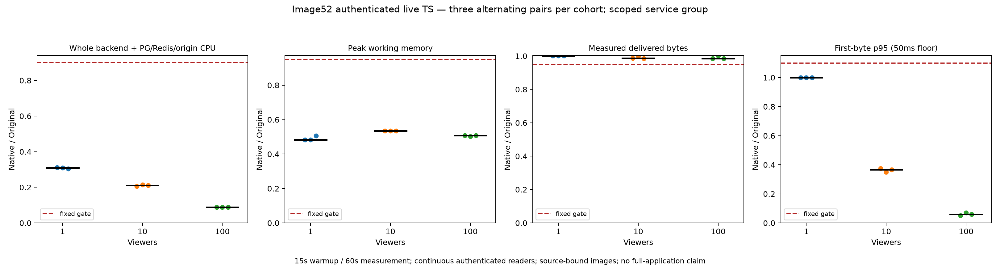

# Image52 authenticated live resource result

Image52 passes nine fixed alternating Original/native pairs at 1, 10 and 100 authenticated live readers, with 666 measured readers and 1,062 complete resource samples. Median paired CPU reductions are 69.07%, 78.93% and 91.16%; peak working-memory reductions are 51.63%, 46.56% and 49.24%, respectively. All pairs pass the unchanged throughput, first-byte latency, pacing, error, OOM and cleanup gates.

The scope is the active live HTTP backend plus common PG/Redis and deterministic origin, under fixed service limits. Background workers, browser/driver, Docker daemon and the full application graph are excluded. No full-M2, rewrite or cross-image gain acceptance follows. Original Dispatcharr and dependency authors retain full code, algorithm and license credit.

The measured image is `sha256:983dc2ba0b740d97abf45cd3a51bf96633b75fbce8cbe9ea678bad36647d9b44`, app revision `98e447186af099dd17496539aec46312f6cf4f62` with 1,285 application inputs, including 788 Rust inputs. Controller support is separately pinned to revision 28122, and all 1,978 executed helper hashes are retained. The six functional phases with 222 readers and the Original-only qualification with 111 readers and 177 samples are separate prerequisites, not additional measured counts.

[Exact numbers, full observations, standalone PNG/SVG, verification controls, input hashes and reproduction](../scripts/rust-live-perf/image52/README.md) are published together. Every actual 2 MiB prefix and decoder transcript was hash checked; bounded audio/video decoding allows startup GOP recovery and does not establish complete timed-body byte equality. Root independently rechecked raw arithmetic, all captures, inputs and exact owned cleanup. Image48's historical results and negatives remain separate.
