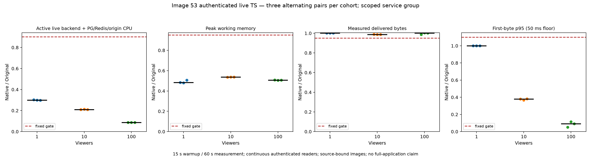

# Image 53 live performance evidence

The fixed authenticated live-stream matrix passed all nine pairs on committed `f0bfc2f200dcfd1f64ae32a9855ea250731ce67f` (791 Rust inputs), using 18 phases and 666 measured readers. There are 1,080 retained raw resource samples and 1,062 complete in-window samples used by the unchanged verifier.

| Readers | Median paired CPU reduction | Median paired working-memory reduction | Minimum delivered-byte ratio |
| --- | ---: | ---: | ---: |
| 1 | 70.11% | 51.72% | 1.0015 |
| 10 | 79.10% | 46.38% | 0.9862 |
| 100 | 91.29% | 49.32% | 0.9865 |

These gains cover the active live HTTP backend plus common PostgreSQL/Redis and local origin under the exact published workload and limits. They exclude background workers, browser/driver, Docker daemon and the full application graph. They do not transfer to the later 792-input notification runtime or image 54 and do not close M2/M4. Full precision, all resource/reader observations, fixed budgets and independent recomputation are in [the portable evidence packet](../scripts/rust-live-perf/image53/README.md).

The separate fresh functional prerequisite has 222 readers without resource sampling. Original-only qualification has 111 readers and 177 in-window samples. All 666 measured 2 MiB prefixes and both decoder transcripts were hash-checked; minimum decode was 72 frames. The packet preserves the rejected qualification admission and initial offline verifier error, neither a measured viewer failure nor an omitted workload retry. All owned measurement resources were independently absent.

Original Dispatcharr authors retain application, algorithm and license credit. The image contains the unchanged pinned Original frontend, LICENSE and ATTRIBUTION; its identity, UID 65532, source/archive and runtime-package bindings are published separately from measured numbers.
