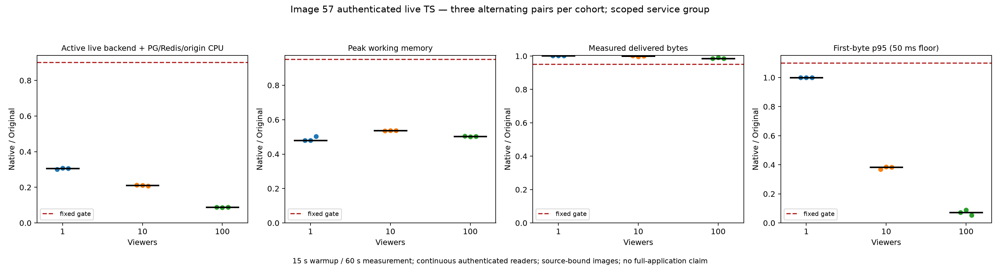

# Image57 live performance

The [reproducible report](../scripts/rust-live-perf/image57/README.md) qualifies nine fixed alternating Source/Rust pairs at1,10 and100 viewers. Every phase used15 seconds of warmup and60 seconds of measurement. All666 continuous authenticated readers passed delivery, video decoding, rate and cleanup checks.

| Viewers | Median paired CPU reduction | Median paired peak working-memory reduction | Lowest delivered-throughput ratio |
| --- | ---: | ---: | ---: |
| 1 | 69.33% | 52.08% | 1.001482 |
| 10 | 78.85% | 46.30% | 0.996329 |
| 100 | 91.17% | 49.63% | 0.984514 |

This measures the authenticated live HTTP backend plus identical shared PostgreSQL/Redis infrastructure and a deterministic owned MPEG-TS origin. It excludes background workers, browsers, the driver and Docker daemon. Working memory is the simultaneous service-group working set, not process RSS or independent peak sums. Worst paired throughput was1.55% below Source. These are synthetic video-only results, not audio, all playback profiles, or whole-application measurements.

The candidate is immutable Git `d77f25fa94ee128c79ade9176d8eb4a9d23bf498`, image `sha256:fc5ea2aba28f86a3ebf3672f6bf8d874a6f79b2d9dd4c8a1efb8993de680375a`:839 Rust inputs,495 unchanged React inputs and two original credit files. The preceding [functional checkpoint](rust-image57-validation.md), six functional phases/222 readers, and separate Source-only qualification/111 readers are distinct prerequisites. No gains transfer to later library unions, new jobs/APIs or the full backend.

Root independently recomputes all18 phases/nine pairs, verifies1,080 raw samples/1,062 complete in-window samples and1,998 retained prefix/decoder hashes. Actual decoded video reaches at least72 frames; no claim says every retained prefix byte was decoded. All76 original controller controls and85 publication-suite methods pass, including30 explicit complete-run controls. Fresh cleanup checks cover18 separate backend container identities plus common infrastructure and origin, with23 exact project/container queries. Failed preparation and reviewer-only assumptions remain documented; no workload was retried or adapted.

The public packet preserves the complete selected numeric observations, immutable input bindings and portable verification/reconstruction tools. Raw-run controls require their explicit retained input; portable controls use the shipped projection. Neither a consumed cue nor a published report authorizes another run. Full M0–M9 acceptance, default worker activation and broader API/media parity remain open.

Original Dispatcharr authors and contributors retain all application, algorithm and license credit. See [ATTRIBUTION.md](../ATTRIBUTION.md) and [LICENSE](../LICENSE).
