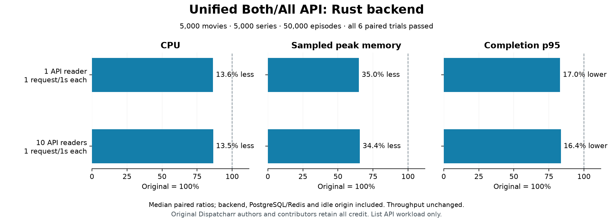

# Unified Both/All catalogue performance — image36

All application and algorithm credit belongs to the original Dispatcharr authors
and contributors. AGPL licensing remains unchanged.

All six predeclared paired trials passed for the unified Movie+Series list API.
These results apply to the exact image36 and workload below, independently of
historical ordinary-list/category experiments and later migration images.

| API readers | Requests per reader | CPU reduction | Sampled peak working-memory reduction | Completion p95 reduction | Throughput ratio |
| --- | --- | ---: | ---: | ---: | ---: |
| 1 | 1/second | 13.6% | 35.0% | 17.0% | 1.000 |
| 10 | 1/second | 13.5% | 34.4% | 16.4% | 1.000 |

Changes are medians of three paired ratios per workload, with alternating backend
order. Every pair must pass; a favorable median cannot override a failed pair.
CPU uses complete-window cgroup counters for the selected service group.
Memory is the largest sampled sum of Docker working memory across that group,
not a continuous allocator peak or a sum of unrelated component peaks.

## Workload and acceptance

The fixed request is `/api/vod/all/?page_size=24`, using a shared Standard account.
The owned catalogue contains 5,000 movies, 5,000 series, 50,000 episodes and 25
logos. Active provider associations make 4,500 movies and 4,500 series visible.
Unique names avoid unresolved tied ordering. Every measured response contains
a total count of 9,000 and 24 results and matches the actual Original raw bytes and typed JSON.
No provider refresh, artwork fetch, video playback or browser runs during timing.

An independent functional gate first compares one/ten unstaggered readers.
Eight Original-only qualification phases select among the declared 10/5/2/1-second
periods. The highest feasible rate is one second for both reader counts. The
selected plan is frozen before native resource measurements. Qualification and
measurement use separate fresh parent coordination records; competing builds,
fixtures and cleanup are paused throughout. Rates and budgets are not adjusted
using candidate results.

Each measured phase has 15 seconds of warmup and 60 seconds of observation. All 12
phases passed with 720 resource samples and 3,960 verified successful requests.
Measured errors, sampler errors, late completions, OOM events and counter resets
are zero. Numerical evidence also retains the eight qualification phases,
120 additional samples and 298 request traces: 840 samples/4,258 traces overall.
Warmup records remain in the hash-bound private phase files.

The measured group includes one backend, PostgreSQL/Redis infrastructure and the
idle origin. Finite limits are backend 2 CPU/512 MiB, infrastructure 1 CPU/1 GiB and
origin 2 CPU/1 GiB. Component counters remain visible in the evidence. Process RSS
is not summed into the headline memory result. Fixture fingerprints cover all
fields of the owned content, logos, provider accounts/associations and settings;
schema fingerprints cover selected column metadata, not every constraint/index.

Acceptance requires CPU and memory ratios ≤1.0, completion p95 ≤1.10,
TTFB ≤1.10 with a 50 ms floor, throughput and pacing ≥0.95, at least 60 samples per
measured phase and zero measured errors/late/OOM/resets. Both aggregate and the
single declared endpoint must pass. Parent review independently recomputes raw
cgroup deltas, service sums, memory formulas, request counts and paired medians,
and verifies the owned containers, networks and volumes are absent.

## Reproducibility and evidence

Original revision: `1241b3f7ffb2e64c8d1157ecd5e3b199af1ae430`.
Candidate revision: `bce2b10632227a554d764e231e763003ed0773f4`.
Candidate image: `sha256:ab0c5e9c7073f14327254f82420507ed8b82b97dcf1d64bedc3d3bd6d3d67539`.
Controller revision: `66e44effed0243bfc43057f9f6296bbdc53aac44`.

- [Fixed policy and budgets](../scripts/rust-unified-perf/policy.json)
- [Accepted resource summary](../scripts/rust-unified-perf/verified-resources-image36-1.json)
- [Sanitized numerical samples and request traces](../scripts/rust-unified-perf/evidence-experiment-image36-1.json)
- [Functional-only proof](../scripts/rust-unified-perf/verified-functional-image36-1.json)
- [Harness and command instructions](../scripts/rust-unified-perf/README.md)

The successful private run is `artifacts/rust/unified-experiment-image36-2`;
parent review is `artifacts/rust/unified-perf-parent-final-review-1.json`.
The first attempt completed qualification but was deliberately refused measurement
authorization after a two-endpoint comparison assumption was found in the
single-endpoint controller. It started no paired measurement and cleaned up.
The corrected controller passes five safety controls, then repeats qualification
with unchanged policy, fixture and budgets. That failed attempt remains retained.

These are metadata API results. They do not establish live/video performance,
active-session recovery, full browser/HTML parity, complete M5 acceptance or a
whole-application performance gain. Later images require their own evidence.
