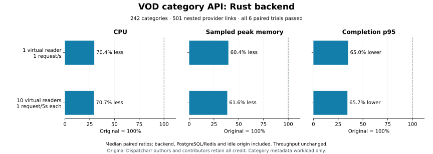

# Category metadata reads: image34

All application and algorithm credit remains with the original Dispatcharr authors and contributors. The Rust rewrite retains AGPL licensing.

All six paired trials passed the declared resource, response, pacing and latency gates. These results apply to `/api/vod/categories/?ordering=category_type,name` on the fixed fixture below. They do not establish complete VOD, browser, media, provider, artwork, unified or whole-application gains.

| Virtual readers | Request interval per reader | CPU reduction | Sampled peak working-memory reduction | Completion p95 reduction | Throughput ratio |
|---|---|---|---|---|---|
| 1 | 1 second | 70.4% | 60.4% | 65.0% | 1.000 |
| 10 | 5 seconds | 70.7% | 61.6% | 65.7% | 1.000 |

Percentages use the median of three paired candidate/Original ratios. Every individual pair passed; medians do not override failures. CPU covers complete-window cgroup counters for the backend, PostgreSQL/Redis infrastructure and idle origin; 100% means one core. Memory is the peak of one-second sampled Docker working-memory sums for the same service group, not RSS, an allocator bound or a continuous peak. Individual service counters, samples, warmup timings and request traces remain in the numerical evidence.

The fixture contains 242 ordered categories and 501 nested provider links, including inactive/STD providers and 177 disabled links. Three active XC accounts, one inactive XC account and one active STD account expose provider/profile metadata. Content/poster tables are empty. A Standard user with movie and series access issues the requests. Each successful body must match the exact 97,835-byte Original response, SHA256 `317cfa35aba27dff2b1a5e5803cb9a0f0d007e25dea4a1c2b0cd0f0ef2ce7af1`, including types and order; equivalent reordered JSON is rejected. The fixture snapshots all fields of User, M3UAccount, M3UAccountProfile, VODCategory, M3UVODCategoryRelation and CoreSettings, verifies content-table emptiness and selected schema metadata, and rechecks them between phases. This is not a fingerprint of every database table or every DDL property. The owned origin received no provider requests.

Source qualification tried the declared 10/5/2/1-second intervals separately for one and ten readers. A fresh Source observer smoke check preceded qualification. One reader qualified at one second; ten readers qualified at five seconds. At ten readers, two/one-second intervals achieved pacing fractions 0.6/0.293333 and each had ten late completions. Those infeasible qualification observations remain in the evidence. Their raw HTTP error count was zero and response bodies passed. The qualification projection's `errors:1` and `correct_responses:false` encode the pacing eligibility failure; they do not mean an HTTP or response mismatch. Both raw phases and eligibility projections are preserved.

Each measured phase used 15 seconds warmup and 60 seconds observation, with alternating Original/candidate order across three trials per workload. All 12 measured phases retained 60 samples, zero HTTP/sample errors, zero late completions, zero OOM/counter resets, unchanged fingerprints and limits, and exact responses. There were 720 measured samples and 1,080 measured responses; measured phases plus their warmups contain 1,350 timings. Across all 20 qualification/measured phases there are 840 resource samples, 1,262 observation-window request traces and 1,601 timings including their warmups, all derived from retained arrays. Backend limits remained two CPUs/512 MiB, infrastructure one CPU/1 GiB, idle origin two CPUs/1 GiB. No target rates, fixture sizes, runtime settings or acceptance budgets changed after candidate observation.

The fixed gates required CPU and memory ratios no greater than 1.0, completion p95 no greater than 1.10, TTFB no greater than 1.10 times the larger of Original TTFB and 50 ms, throughput and pacing at least 0.95, at least 60 samples, and zero errors/late completions/OOM/resets. The exporter recalculates cgroup deltas and event/limit stability, per-sample group-memory sums, nearest-rank p95 traces, completed counts, pair and endpoint acceptance, Source-only pacing and immutable plan identity. Static corruption controls reject changed counters, timings, memory, late counts and secret-bearing traces. JWT-bearing phase controls, fixture metadata and tokens remain private.

## Exact bindings

- Git revision: `a84d4acafe7bf70667129c5d6ddf3c74b2b505d5`.
- Image: `sha256:b0034daea0add637f63f01702be047a02d32d78c9f03089ed093065e2a0c92c9`.
- Rust tree: `01977eb04b0e1ba70e75a6b0230a986f5ba9a3245b51fa1853e10a7e7ed5fc11`.
- Build manifest SHA256: `ec229ae670e1fe377d2d7778d94c69df04f1b36106f65dbc6ace03bbbf213712`.
- Prebinding spec SHA256: `be87890e587eb8c6175cdc7c906a915d652d0b5be3eff30bcd4bc3242b362f9b`.
- Bound policy SHA256: `a069f665602ad1565ebc9c7ddb10d63cbd2da51a6c07474223630f7ec331dcb3`.
- Source-selected plan SHA256: `4093c50ac6091ae387b76591e261be7fb292483f6fb199ffc46ba589c782c9a5`.
- Successful captured tool map SHA256: `e16d65ad0eeafe55712a3a0689f8c0a1b4a9f41d67c36463393df03f72ea6a46`.

[Verified summary](../scripts/rust-vod-category-perf/verified-experiment-image34-1.json) · [Numerical evidence](../scripts/rust-vod-category-perf/evidence-experiment-image34-1.json) · [Protocol and reproducible commands](../scripts/rust-vod-category-perf/README.md)

Private raw evidence remains under `artifacts/rust/vod-category-resource-experiment-1`. The parent independently recomputed all six pairs and verified owned containers, networks and volumes were absent before releasing the quiet window. Historical image31 ordinary-list and image33 functional proofs retain their own scopes; no gains from this workload are transferred to those images or to other endpoints. Uncaptured category grammar and other VOD capabilities remain separate migration gates.
