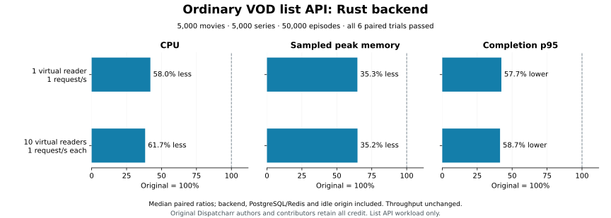

# Ordinary VOD list API performance — image31

Original Dispatcharr authors and contributors retain all application and
algorithm credit, branding and AGPL licensing. These measurements describe a
derivative Rust backend port with the existing React source preserved.

The complete six-pair experiment passes its frozen gates. The
[numerical report](../scripts/rust-vod-perf/verified-resources-image31-1.json),
[all phase samples and request timings](../scripts/rust-vod-perf/evidence-experiment-image31-1.json),
and [contract/scope report](../scripts/rust-vod-perf/verified-experiment-image31-1.json)
bind the results to the exact application, tools, fixture and policy.

| Virtual readers | Requests per reader | CPU decrease | Sampled peak working-memory decrease | Completion-p95 decrease | Throughput ratio |
| --- | ---: | ---: | ---: | ---: | ---: |
| 1 | 1/second | 58.0% | 35.3% | 57.7% | 1.0 |
| 10 | 1/second | 61.7% | 35.2% | 58.7% | 1.0 |

Percentages use the median paired Rust/original ratio across three trials per
workload. Every individual pair passes. Median absolute group working memory is
693.2→448.4 MiB for one reader and 701.4→454.7 MiB for ten. Median completion p95
is 49.9→21.1 ms and 50.3→20.9 ms respectively. Absolute values are independent
backend medians; their ratio need not equal the median paired ratio.

## Workload and accounting

Each virtual reader alternates movie and series list requests with
`ordering=name&page_size=24`. Each endpoint therefore receives one request every
two seconds per reader. The unchanged React application uses a 24-card page
setting, but this experiment makes direct HTTP requests with a fresh loopback
connection for each request. It does not execute the browser or play video.

The generated catalogue contains 5,000 movies, 5,000 series and 50,000 episodes,
with 25 shared logos and three provider accounts, two active. Exactly 4,500
movies and 4,500 series are visible to the shared Standard account. Unique names
and explicit ordering make page membership deterministic. Every response must
match original status, MIME, raw byte length/hash, JSON types and array order;
both aggregate and per-endpoint latency/throughput gates apply. Independent
unstaggered ten-reader bursts pass for both endpoints.

CPU is the sum of complete-window cgroup CPU usage/time for the backend,
PostgreSQL/Redis infrastructure and idle origin. 100% means one CPU core.
Memory is the maximum sampled sum of Docker working memory for the same group,
not continuous allocator/cgroup peak or process RSS. Docker CPU sample values
are retained as diagnostics; headline CPU uses the full-window cgroup counters.
Backend limits are 2 CPUs/512 MiB, infrastructure 1 CPU/1 GiB, and idle origin
2 CPUs/1 GiB. Both backends use the same service limits and dataset.

The fixture fingerprints Movie, Series, Episode, VODLogo, M3UAccount, the three
content-provider relation tables and CoreSettings rows. User, account-profile,
category and category-relation rows are outside that row fingerprint. Column
schema snapshots and exact response checks add separate guards; the schema
snapshot does not cover every constraint/index definition. The scoped report
lists these boundaries explicitly.

## Protocol and retained evidence

Before resource observations, policy
`f8c3158b678f91f3b98fc79b8ac7b22d76f755ec9e460905ecaae3ba9b32ec4c`
fixed the data, limits, candidate, workloads and acceptance gates. A Source-only
observer check passed ten samples with CLI/direct memory agreement, inspected
limits and monotonic counters. Eight original-only qualification phases tested
10/5/2/1-second periods with 5-second warmup and 15-second observation. Each
phase produced 15 samples without errors or late completions. Both workloads
selected one second without using Rust resource values.

Frozen plan
`d86aae87c6e91f196449cfeb0a48e5d34e94f6057882133172db4610a9ba2c17`
then received a separate coordinated measurement cue. Each workload ran
original→Rust, Rust→original, original→Rust pairs. Every measured phase has a
15-second warmup, 60-second observation and 60 resource samples. All 12 measured
phases pass with zero request/sample errors, late completions, OOM events or
counter resets. Their 3,960 responses pass exact entity checks. Public evidence
contains 840 samples and 4,258 request timings across all 20 qualification and
measurement phases, excluding warmup timings.

CPU and memory ratio ceilings are 1.0, completion-p95 ceiling 1.10, TTFB ceiling
1.10 with a 50 ms original floor, throughput minimum 0.95 and pacing minimum
0.95. Medians cannot override a failed pair or endpoint. Competing agent builds
and fixtures were paused throughout qualification and measurement. The owned
Compose project was removed; an independent Docker check found no running
containers before other work resumed.

The first attempt failed before observation: an inherited media-origin
entrypoint exited because its media imports were unavailable. The observer
refused the missing service. That attempt and cleanup remain recorded. The
retry used the existing idle-origin fixture with explicit health/count guards;
data, candidate, limits and budgets stayed unchanged.

## Source binding and reproduction

The original is pinned revision
`1241b3f7ffb2e64c8d1157ecd5e3b199af1ae430` and image
`ghcr.io/dispatcharr/dispatcharr@sha256:34f9011514edd31ef0ff111b5f256d2e37614fcb08a6ee1ed9eccec9251a856f`.
The candidate was built from committed `db532d02`:

* Image: `sha256:5d4a6f84842b960a9d1b39f35d099a598149fb2e189f3ba0d8dafd0b4e48b02a`.
* Source tree: `9c8a48c474f0bdfa04b1172fd59a1657c7e9e5385c70e040a52dff645a3456e6`.
* Archive: `0645251fb7c85d8886482157577041aa5da6b198466327c6ea13f150e82eecc0`.
* Retained run: `artifacts/rust/m5-vod-perf-experiment-image31-2`.

[The harness README](../scripts/rust-vod-perf/README.md) describes functional and
coordinated measurement entrypoints. [The ordinary-read guide](rust-vod-reads.md)
shows the committed application build and API/browser regression commands.
`scripts/rust-vod-perf/publish.py` verifies the retained complete matrix and
produces sanitized numerical output; `plot.py` renders the accepted ratios.

These gains accept the named ordinary-list workload. Categories, unified reads,
nested actions, provider refresh, artwork, complete VOD browser flows, media
performance and whole-application migration remain separate gates. Image28
Current/XMLTV and image30 grid gains keep their own bindings; none of these
experiments supplies a combined whole-application saving or closes a complete
migration milestone.
