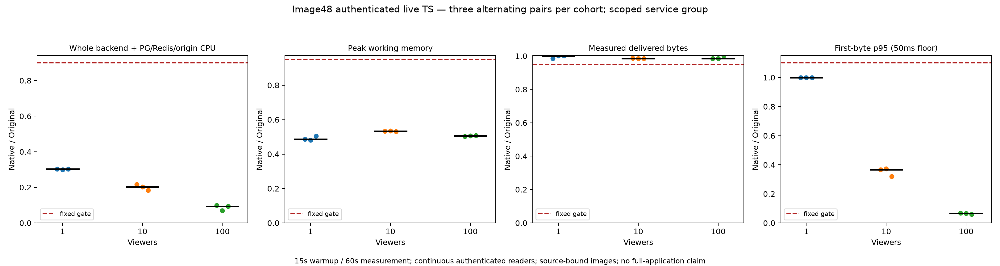

# Image48 authenticated live-stream resource comparison

Original Dispatcharr authors and contributors retain all application and algorithm
credit and their original licenses. This checkpoint ports and measures their
application; it claims no authorship of Dispatcharr.

Nine predeclared alternating Source/native pairs pass at 1, 10 and 100 viewers.
Each phase has 15 seconds of warmup and 60 seconds of measurement, with one
continuous authenticated request per viewer. All 666 readers pass their bounded
audio/video decode and Redis user-identity checks. The complete matrix retains
1,062 in-window resource samples. Every pair passes unchanged CPU, memory,
throughput, latency, error, OOM and cleanup budgets.

| Viewers | Median paired CPU reduction | Median paired peak working-memory reduction | Minimum throughput ratio |
| --- | ---: | ---: | ---: |
| 1 | 69.74% | 51.40% | 0.9845 |
| 10 | 79.71% | 46.72% | 0.9845 |
| 100 | 90.72% | 49.40% | 0.9845 |



These numbers cover image48's active live HTTP backend plus common, separately
limited PostgreSQL/Redis infrastructure and deterministic origin. Source runs
uWSGI and Daphne; native runs the packaged Main binary. Background workers and
the full application graph are outside this comparison. Docker daemon and driver
overhead are also excluded. This checkpoint does not close M2 or establish gains
for later application changes. Lifecycle, owner-loss, churn, UI workflows and
full-service acceptance remain milestone requirements.

## Verify the published numbers

No Docker, retained private artifacts or third-party Python packages are required:

```sh
python3 scripts/rust-live-perf/image48/verify_projection.py \
  --projection scripts/rust-live-perf/image48/projection.json
python3 -m unittest discover -s scripts/rust-live-perf/image48 -p test_public.py -v
python3 -m unittest discover -s scripts/rust-live-perf/image48 -p 'test_*resources.py' -v
python3 -m unittest discover -s scripts/rust-live-perf/image48 -p test_acceptance.py -v
python3 -m unittest discover -s scripts/rust-live-perf/image48 -p test_controller_contract.py -v
python3 -m unittest discover -s scripts/rust-live-perf/image48 -p test_workload.py -v
```

The public wrapper runs all 30 complete-run corruption controls against the
published observations, without skipping for a missing local recording. The
executed controller has 42 separate workload/resource/acceptance/matrix controls.
`verify.py` independently recomputes all per-service CPU deltas, simultaneous
working-memory sums, sample cadence/coverage, exact limits, work, pair ratios and
cohort medians. `projection.json` publishes those observations and all reader
capture/decoder hashes. It does not contain tokens or copied user configuration.

Raw media remains local: the publisher verified all 666 retained 2MiB prefixes
and decoder transcripts against their hashes. Each decode permits startup GOP
recovery, requires audio/video and at least 25 video frames, and caps decoded
output at five seconds. Original startup probe diagnostics are preserved. This
does not prove clean decoding of every raw prefix byte or Source/native timed-body
byte equality. Full-media equality belongs to the separate core gates.

Matplotlib can regenerate the standalone PNG/SVG into a **new** directory:

```sh
python3 scripts/rust-live-perf/image48/plots.py \
  --projection scripts/rust-live-perf/image48/projection.json \
  --output /tmp/dispatcharr-live-plots-NEW
```

## Repeat the Docker Compose experiment

`execution-inputs.json` records every executed helper hash and its support Git
revision, `28122faf28a0acf1c136ca0d0831961e786cb686`. Use a separate checkout at
that revision for `--repo`; invoke this directory's exact `run.py` by absolute
path. It copies these tools into the committed support snapshot. Outputs must be
new directories. Docker Compose, Python 3 and the pinned Original image are
required. Fixtures use synthetic local data and loopback ports.

`application-inputs.json` records all 1,243 exact application input hashes, source
tree hash and measured image ID. Every input was independently compared with
committed `fda49b16d5e3aca1e2c95ce01fc2b4d558e77572`. To rebuild those inputs:

```sh
python3 scripts/rust-integration/build.py \
  --git-revision fda49b16d5e3aca1e2c95ce01fc2b4d558e77572 \
  --output artifacts/rust/live-image48-rebuild-NEW
```

A rebuild may produce a different image ID. Use its own passing build manifest;
never transfer these measured gains to a different digest. This independent
numeric verifier intentionally accepts only the actual measured digest.

Run `--action functional` first with `--build-manifest BUILD/build.json` and
`--output OUTPUT`. Before resource runs, coordinate an otherwise idle host:
no competing builds, tests, containers, samplers or cleanup. The controller
requires an explicit JSON `--quiet-cue` with `quiet_active: true`, `action`
(`qualify` or `measure`), exact `candidate_image`, `plan_sha256`, host `boot_id`
from `/proc/sys/kernel/random/boot_id`, and a future Unix `expires_epoch`.
This is an experiment-integrity guard; do not reuse this run's expired cue.

Run `--action qualify` first: Original-only 1/10/100 windows must meet the fixed
rate, CPU/memory headroom, cadence and zero-error budgets. Independently review
the result, then write a review JSON containing `passed: true`, `windows: 3`,
`Native_resource_measurements: false`, exact `protocol_sha256` and qualification
`report_sha256`. A fresh measurement cue additionally names
`Source_qualification_review`, its `Source_qualification_review_sha256`, and
`Source_qualification_report`. Use absolute paths. `--action measure` verifies
these bindings and that the five workload/protocol tools are unchanged before
running all nine pairs. Preserve every failure; do not select successful pairs,
adapt budgets or silently retry. `run.py --help` lists the common arguments.

Backend limits are 2 CPU/512MiB per side; shared PG/Redis is 1 CPU/1GiB and origin
2 CPU/512MiB. CPU comes from whole-cgroup `usage_usec` over actual elapsed time;
working memory is usage minus inactive file (with the recorded fallback).
Service memory is summed within each simultaneous sample before taking its peak.
Readers remain open until the final counter barrier, so connection cleanup CPU
does not contaminate the measurement. Fixed acceptance requires CPU ratio ≤0.90,
memory ≤0.95, throughput ≥0.95 and p95 first-byte ratio ≤1.10 with a 50ms floor;
each reader must sustain 225,000–275,000 bytes/second. All 18 phases independently
pass, and owned containers, networks and volumes are absent afterward.

`publish.py` accepts explicit complete raw output, parent review and new output
paths. It rechecks tool, report, phase, media and transcript hashes before
publishing. The immutable protocol's preparatory status strings describe when it
was sealed; the completed report and independent review record execution status.

The actual support snapshot also contains 17 relocated, non-runtime image47
publication assets because the runner copies its launch directory over the support
archive. `support_snapshot_relocations` records their committed origins explicitly.
They supply no image48 observations; this directory publishes the newly measured
image48 projection. Replays record their own complete support snapshot.

Publication validation passed 77 discovered tests with no skips, including the
42 controller controls and 30 raw complete-run controls; the public wrapper also
ran its 30 corruption controls. All 1,243 application inputs and 1,982 support
inputs were hash-checked against their declared committed origins.
