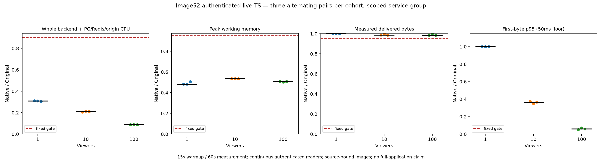

# Image52 authenticated live-stream resource comparison

Nine fixed alternating Original/native pairs passed at 1, 10 and 100 authenticated continuous readers. Each phase used 15 seconds of warmup and 60 seconds of measurement. All 666 readers passed identity, single-request delivery, bounded audio/video decode and cleanup gates. The matrix retains 1,062 complete in-window resource samples; every pair passed unchanged budgets.

| Readers | Median paired CPU reduction | Median paired peak working-memory reduction | Minimum delivered-byte ratio |
| --- | ---: | ---: | ---: |
| 1 | 69.07% | 51.63% | 1.0015 |
| 10 | 78.93% | 46.56% | 0.9862 |
| 100 | 91.16% | 49.24% | 0.9845 |



These measurements cover image52's active live HTTP backend plus common, separately limited PostgreSQL/Redis infrastructure and deterministic local origin. CPU is the sum of whole-window per-service cgroup CPU deltas. Peak working memory is the peak of simultaneous three-service sample sums, subtracting inactive file memory according to the published arithmetic. This is not summed per-service independent peaks, process RSS or full application memory. Each backend and origin has limits of 2 CPUs and 512 MiB; common PG/Redis has 1 CPU and 1 GiB. Background workers, browser/driver, Docker daemon and the full application graph are excluded. These numbers do not close M2 or establish gains for other images/workloads.

Original Dispatcharr authors and contributors retain all application, algorithm and license credit. Pinned Original is `1241b3f7ffb2e64c8d1157ecd5e3b199af1ae430`, image `sha256:34f9011514edd31ef0ff111b5f256d2e37614fcb08a6ee1ed9eccec9251a856f`. Measured native image is `sha256:983dc2ba0b740d97abf45cd3a51bf96633b75fbce8cbe9ea678bad36647d9b44`, committed app `98e447186af099dd17496539aec46312f6cf4f62`. `application-inputs.json` binds all 1,285 application inputs, including 788 Rust inputs, unchanged Original frontend/LICENSE, source tree/archive and pinned FFmpeg/runtime-package hashes. Actual runtime UID 65532 and LICENSE/ATTRIBUTION were independently checked.

## Verify without Docker or private artifacts

```
python3 scripts/rust-live-perf/image52/verify_projection.py --projection scripts/rust-live-perf/image52/projection.json
python3 scripts/rust-live-perf/image52/test_public.py
python3 scripts/rust-live-perf/image52/verify_prerequisites.py
python3 scripts/rust-live-perf/image52/test_prerequisites.py
```

The public wrapper runs all 30 complete-run controls against the public observations with no skipped private fallback. Those same 30 controls also ran against the actual retained raw run before publication. The additional prerequisite controls reject missing phases, identity/decoder errors, a sampler in functional mode, Native substitution in Source qualification, bad images/protocol, OOM/missing samples, broken authority binding and incomplete cleanup. `verify.py` independently recomputes all sample coverage/cadence, limits, per-service CPU deltas, memory sums, reader pacing, pair ratios and cohort medians. CPU ratio must be at most 0.90, working-memory ratio at most 0.95, delivered-byte ratio at least 0.95 and first-byte p95 ratio at most 1.10, with the fixed 50 ms floor.

`functional.json` separately records the six fresh functional phases with 222 readers, with resource fields null. `qualification.json` separately records three Original-only qualification windows with 111 readers and 177 samples. These are prerequisites, not extra measured pairs or part of the 666 measured-reader count. Their recovered startup `RemoteDisconnected` readiness diagnostic is preserved separately from actual viewer outcomes. No Native resource values were collected in Original qualification.

`projection.json` contains all measured reader/resource observations, hashes of retained prefixes/decoder transcripts and all nine pair data. Before publication, the publisher verified all 666 actual 2 MiB files and both decoder transcripts. Decode requires audio/video and at least 25 video frames within five seconds, allowing startup GOP recovery. Actual minimum was 72 frames. This does not prove clean decoding of every raw prefix byte or timed Original/native body equality. Full media stays private; published hashes bind the checked captures. First-byte latency and delivered bytes are workload observations, not claims about unrelated endpoints.

`cue-claim-chain.json` binds consumed functional/qualification/measurement authorities and exclusive claims by hash. Boot IDs, PIDs, private auth, actual host argv and copied data are excluded. These sanitized records are provenance and cannot authorize another execution. `parent-review.json` retains Root's independent raw recomputation and exact cleanup scope. All owned measurement containers/networks/volumes were independently absent.

## Reproduce inputs and repeat safely

`execution-inputs.json` records all 1,978 executed helper hashes and 1,970 support files. Support Git is independently pinned `28122faf28a0acf1c136ca0d0831961e786cb686`, distinct from application revision 98e. A detached private Git metadata directory with read-only object alternates made nested `git archive HEAD` resolve revision 28122; the real mutable HEAD was not treated as frozen support. Reconstruct that support revision's `docker`, `scripts` and `docs` in a separate checkout; invoke this directory's exact `run.py` by absolute path. It overlays its exact controller files on that committed support archive.

Build the app with `scripts/rust-integration/build.py --git-revision 98e447186af099dd17496539aec46312f6cf4f62` into a new output. A rebuilt digest requires fresh manifest/image validation and its own experiment; it inherits no gains. The independent numeric verifier deliberately accepts only this measured digest. Original full archive must be `f2323ac705be2af5d1c264f26b1d297cb2bede53874e6bceccee4bf6603fa7ff`.

Run fresh functional phases first (`--action functional --viewers 1 10 100`). Resource work requires a coordinated quiet host and fresh boot/expiry-bound Root cue, Source-only qualification and independent review, then a separate measurement cue binding that review/report. Use fresh outputs, fixed order Source/native, native/Source, Source/native per cohort, unchanged protocol/budgets and no adaptive retries or passing-pair selection. Historical cues are consumed. Default recovery/default worker graph remain off; this experiment does not activate them.

Standalone figures can be regenerated with Matplotlib into a new directory:

```
python3 scripts/rust-live-perf/image52/plots.py --projection scripts/rust-live-perf/image52/projection.json --output /tmp/image52-live-plots-NEW
```

The PNG/SVG source projection hash is retained in `figures/figure-source.json`. Historical image48 and failed/partial evidence remain unchanged; these results are new, scoped image52 measurements rather than transferred acceptance.
