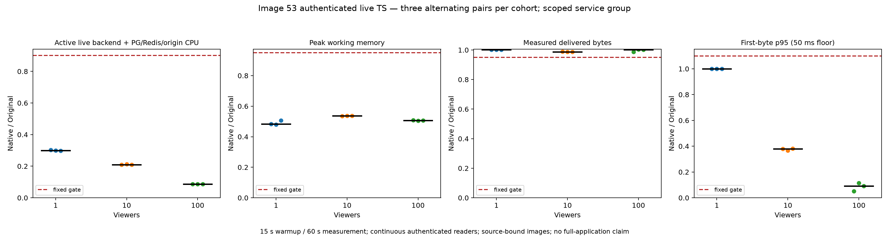

# Image 53 authenticated live-stream resource comparison

Nine fixed alternating Original/native pairs passed at 1, 10 and 100 authenticated continuous readers. Each phase used 15 seconds of warmup and 60 seconds of measurement. All 666 measured readers passed identity, single-request delivery, bounded audio/video decode and cleanup gates. The retained matrix contains 1,080 raw resource samples; the unchanged verifier includes 1,062 complete in-window samples in its arithmetic. All nine pairs passed the original fixed budgets.

| Readers | Median paired CPU reduction | Median paired peak working-memory reduction | Minimum delivered-byte ratio |
| --- | ---: | ---: | ---: |
| 1 | 70.11% | 51.72% | 1.0015 |
| 10 | 79.10% | 46.38% | 0.9862 |
| 100 | 91.29% | 49.32% | 0.9865 |



These results apply only to measured image `sha256:3f599a036bf0ba15f7d47f4f28016777fba9586cb328afd10a25cac16293f4f0`, application revision `f0bfc2f200dcfd1f64ae32a9855ea250731ce67f` and its 791 Rust inputs. They do not apply to the later 792-input notification runtime or image 54. `application-inputs.json` binds all 1,288 application inputs, immutable source tree/archive and FFmpeg/runtime-package hashes. Independent build probes checked runtime UID 65532, LICENSE, ATTRIBUTION and the bundled Original frontend. The build receipt's package-acceptance false is its historical build-only status, preceding the separately completed package/Main gates.

The measured group is the active live HTTP backend plus common PostgreSQL/Redis and deterministic local origin. CPU uses whole-window service cgroup CPU deltas. Peak working memory is the maximum simultaneous three-service sample sum, subtracting inactive file memory according to the published arithmetic. It is neither process RSS nor the sum of independent service peaks. Backend and origin each have 2 CPU / 512 MiB limits; common PG/Redis has 1 CPU / 1 GiB. Background workers, browser/driver, Docker daemon and the whole application graph are excluded. This is not full M2/M4 or whole-backend acceptance. Default worker and recovery activation remain unchanged.

Original Dispatcharr authors and contributors retain all application, algorithm and license credit. Pinned Original is `1241b3f7ffb2e64c8d1157ecd5e3b199af1ae430`, image `sha256:34f9011514edd31ef0ff111b5f256d2e37614fcb08a6ee1ed9eccec9251a856f`. The full Original archive is bound to `f2323ac705be2af5d1c264f26b1d297cb2bede53874e6bceccee4bf6603fa7ff`. The application retains its Original frontend, LICENSE and ATTRIBUTION.

## Verify locally without Docker or private artifacts

```
python3 scripts/rust-live-perf/image53/verify_projection.py --projection scripts/rust-live-perf/image53/projection.json
python3 scripts/rust-live-perf/image53/test_public.py
python3 scripts/rust-live-perf/image53/verify_prerequisites.py
python3 scripts/rust-live-perf/image53/test_prerequisites.py
python3 scripts/rust-live-perf/image53/verify_delivery.py
python3 scripts/rust-live-perf/image53/test_delivery.py
```

The public wrapper executes all 30 complete-run controls against public observations, without a private fallback or skips. The same 30 controls ran against the actual retained raw measurement. Additional prerequisite, projection, input/privacy and reconstruction controls reject missing phases, identity/decoder errors, unexpected functional sampling, Native substitution in Source qualification, changed images/protocol, OOM, missing samples, broken review binding and incomplete cleanup. `verify.py` recomputes sample coverage/cadence, limits, per-service CPU deltas, simultaneous memory sums, reader pacing, pair ratios and cohort medians. The gates remain CPU ratio <= 0.90, memory <= 0.95, throughput >= 0.95 and first-byte p95 <= 1.10 with a 50 ms floor.

`functional.json` separately retains six fresh functional phases with 222 readers and null resource fields. `qualification.json` retains three Original-only windows with 111 readers and 177 in-window samples. Neither adds readers or pairs to the measured matrix. Their recovered readiness `RemoteDisconnected` is distinct from viewer failures. `preserved-negatives.json` keeps the rejected qualification admission: an initial review bound integration.json instead of live-functional.json, so no workload ran under that refusal; a corrected review and fresh cue preceded the single qualification. It also records Root's initial offline verifier filename error and empty output, before a corrected offline verification with unchanged measured data. No workload was retried or selected away.

`projection.json` retains every measured reader/resource observation and all nine pair data, including full precision. The publisher verified all 666 retained 2 MiB prefixes and both decoder transcripts per reader. Decode requires audio/video and at least 25 frames within five seconds; the actual minimum was 72. This does not prove clean decoding of every prefix byte or byte equality across Original/native. Full media stays private; its hashes bind the inspected captures.

`cue-claim-chain.json` hashes consumed functional/qualification/measurement authority and exclusive claims. Boot IDs, PIDs, nonces, private authentication, actual host argv and copied database data are excluded. These records cannot authorize a new execution. `parent-review.json` binds Root's independent recomputation, all 1,998 prefix/transcript hash checks and independently empty owned containers/networks/volumes. Resource sample counts explicitly distinguish raw 1,080 from in-window 1,062.

## Reproduce inputs and repeat safely

`execution-inputs.json` lists all 1,978 actual executed helper hashes and 1,970 support file hashes. Support revision `28122faf28a0acf1c136ca0d0831961e786cb686` is distinct from the application revision. A private detached Git metadata directory with read-only object alternates fixed nested `git archive HEAD` to that support revision. It did not trust the shared repository's moving HEAD. `reconstruct_support.py` reconstructs and hash-checks the exact 1,970-file support archive and all 1,978 executed tools using explicit immutable Git objects plus these public overlays. It creates separate detached Git metadata and proves its HEAD archive equals the explicit revision archive. It refuses an existing output and has no mutable/private fallback. For example:

```
python3 scripts/rust-live-perf/image53/reconstruct_support.py --repo . --output /tmp/image53-support-NEW
RECONSTRUCTION_REPO=. python3 scripts/rust-live-perf/image53/test_reconstruct_support.py
```

Use an absolute controller path for any separately authorized run. Reconstruction alone does not launch an application. No targets, binaries or copied database/media data are published.

Build the application only from explicit `f0bfc2f200dcfd1f64ae32a9855ea250731ce67f`. Any rebuilt image requires fresh manifest/input checks and its own experiment; the verifier deliberately accepts only the measured digest. `plan.json` is a sanitized finite historical plan, not an executable cue. New work requires fresh functional phases, a quiet host, independent Original-only qualification/review and a separate bound measurement cue. Retain fixed pair orders Source/native, native/Source, Source/native in each cohort, with no adaptive retries or passing-pair selection. Historical authorities are consumed.

Standalone figures can be regenerated with Matplotlib into a new directory:

```
python3 scripts/rust-live-perf/image53/plots.py --projection scripts/rust-live-perf/image53/projection.json --output /tmp/image53-live-plots-NEW
```

The standalone PNG/SVG and source projection hash are retained in figures/. Prior image 52 results, all historical failures and the separate package/Main scopes remain unchanged. No gain is transferred to another image, workload, default graph or complete application.
