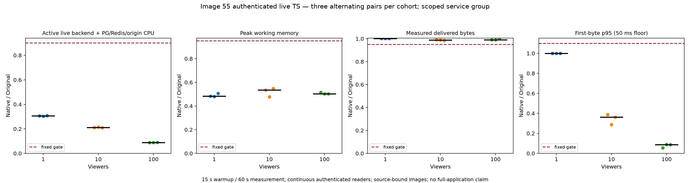

# Image55 authenticated live performance

Nine fixed alternating Original/Rust pairs passed at 1, 10 and 100 viewers. Each phase used 15 seconds of warmup and 60 seconds of measurement. All 666 measured authenticated readers passed single-request delivery, actual audio/video decoding, rate and cleanup checks. The retained data contains 1,080 raw resource samples; 1,062 complete in-window samples enter the arithmetic.

| Viewers | Median CPU reduction | Median peak working-memory reduction | Minimum throughput ratio |
| --- | ---: | ---: | ---: |
| 1 | 69.37% | 51.76% | 1.0015 |
| 10 | 78.89% | 46.54% | 0.9845 |
| 100 | 91.14% | 49.72% | 0.9903 |



These gains bind only image `sha256:120df2f930a7f4d2738a04fbd793c16b230b7a80114f4d6b03f670244940a014`, application Git `aca6d900ad13700ab86b2898134a61e4dba57bc1`, 794 Rust inputs and 1,291 application inputs. The later 806-input recording libraries have separate component tests. No gain transfers to them or to a future image.

The measured group is the authenticated live HTTP backend plus common PostgreSQL/Redis and deterministic local origin. CPU uses whole-window service cgroup deltas. Peak working memory is the maximum simultaneous three-service sum with inactive file memory subtracted; it is not process RSS or a sum of independent peaks. Backend/origin limits are each 2 CPUs/512 MiB; common PG/Redis is 1 CPU/1 GiB. Workers, browser, driver and Docker daemon are excluded. Full M2/M4 and whole-backend acceptance remain open.

Original Dispatcharr authors and contributors retain all application, algorithm and license credit. React, LICENSE and ATTRIBUTION remain unchanged. Pinned Original is `1241b3f7ffb2e64c8d1157ecd5e3b199af1ae430`, image `ghcr.io/dispatcharr/dispatcharr@sha256:34f9011514edd31ef0ff111b5f256d2e37614fcb08a6ee1ed9eccec9251a856f`.

## Verification and reproduction

```sh
python3 scripts/rust-live-perf/image55/verify_delivery.py
python3 scripts/rust-live-perf/image55/verify_projection.py --projection scripts/rust-live-perf/image55/projection.json
RECONSTRUCTION_REPO=. python3 -m unittest discover -s scripts/rust-live-perf/image55 -p 'test_*.py'
python3 scripts/rust-live-perf/image55/reconstruct_support.py --repo . --output /tmp/image55-support-NEW
```

The full reviewed suite passed 85 methods with `LIVE_RETAINED_COMPLETE_RUN` explicitly pointing to the retained private run. With the portable command above, the raw-only test class is explicitly skipped; `test_public.py` independently runs all 30 complete-run controls against the published observations without skips or private fallback. Localhost ownership tests need permission to bind loopback sockets. The same 30 controls also passed against the completed raw run. Root independently recomputed every window/pair and verified all 1,998 retained media/decoder hashes, with at least 72 decoded frames per reader, plus fresh owned project cleanup. Full media bytes and private authentication/cue/boot/PID/host-command data are excluded from this public projection.

`application-inputs.json` binds every app input and immutable build/archive. `execution-inputs.json` binds all 1,970 support files and 1,978 executed helper inputs. Support Git `28122faf28a0acf1c136ca0d0831961e786cb686` is distinct from the application ref. The reconstruction tool checks all inputs and creates an isolated, fixed Git HEAD; it has no mutable/private fallback and never builds or launches workloads.

Separate prerequisite evidence retains six functional phases/222 readers and three Original-only qualification windows/111 readers. It is outside the measured 666-reader matrix. Their actual cleanup inventories are explicitly projected from hash-bound independent receipts; current Root review field names are preserved. `predeclared-plan.json` preserves the exact earlier plan; `plan.json` summarizes completed authority. Neither is a replayable cue. Each future experiment requires a new immutable build binding, independent functional/Original qualification and fresh coordinated quiet cues. Fixed pair orders, budgets and all failed outcomes must remain; no adaptive retries or passing-pair selection.

All three workload children exited zero. Earlier offline preparation, stale-tag, Git-layout and publication-schema/loopback-permission negatives remain explicitly separate in `preserved-negatives.json` and the publication review. They are not viewer failures, reruns or fabricated historical outcomes.
