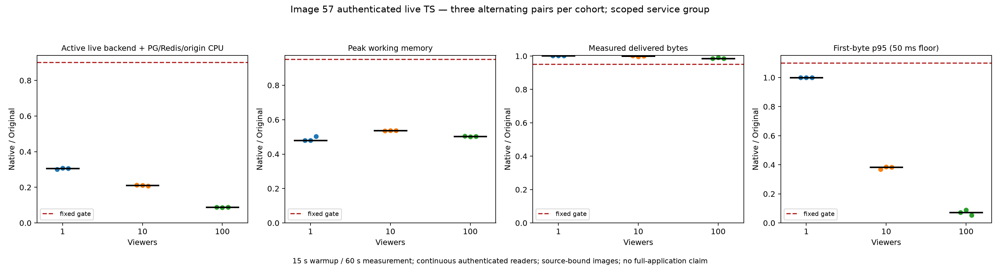

# Image57 authenticated live performance

Nine fixed alternating Original/Rust pairs passed at1,10,100 viewers; each phase used15s warmup/60s measurement. All666 authenticated readers passed single-request delivery, actual video decoding, rate and cleanup gates. There are1080 raw resource samples and1062 complete in-window samples.

| Viewers | Median paired CPU reduction | Median paired peak working-memory reduction | Minimum delivered-throughput ratio |
| --- | ---: | ---: | ---: |
| 1 | 69.3252% | 52.0806% | 1.001482 |
| 10 | 78.8523% | 46.2994% | 0.996329 |
| 100 | 91.1656% | 49.6305% | 0.984514 |

These numbers bind ONLY image sha256:fc5ea2aba28f86a3ebf3672f6bf8d874a6f79b2d9dd4c8a1efb8993de680375a, Git d77f25fa94ee128c79ade9176d8eb4a9d23bf498,839 Rust +495 unchanged Original React +2credits =1336app inputs. Later library/current unions have separate tests and receive no performance transfer. Original Dispatcharr authors/contributors retain all application/algorithm/license credit; LICENSE/ATTRIBUTION and unchanged frontend input hashes remain explicit.

Scope: authenticated live HTTP backend plus common PG/Redis and deterministic owned origin. CPU uses whole-window service cgroup deltas. Peak working memory is the maximum simultaneous three-service sum minus inactive file memory; it is not process RSS or the sum of independent peaks. Backend/origin each2CPUs/512MiB; commonPG/Redis1CPU/1GiB. Browser/workers/driver/Docker daemon and full graph are excluded. No full rewrite or milestone acceptance follows.

Run `python verify_delivery.py`, `python verify_projection.py --projection projection.json`, then `RECONSTRUCTION_REPO=/path/to/repo python -m unittest discover -s . -p 'test_*.py'`. Portable complete-run controls use published observations with no private fallback. Raw-only tests require explicit LIVE_RETAINED_COMPLETE_RUN; localhost controls require loopback permission. `reconstruct_support.py --repo /path/to/repo --output /fresh/path` recreates all1970 support files at detached28122faf28a0acf1c136ca0d0831961e786cb686; appGit and immutable workloadGit remain distinct. These commands never build or run workloads.

All seven protocol/workload inputs are byte-identical to qualified image55 and immutableaca6. Only candidate binding and namespaces changed. FixedSource/candidate alternating orders and all thresholds stayed unchanged. Fresh6functional phases/222readers (no resources) and Source-only3windows/111readers precede the measured matrix and remain separate observations. Consumed cue/claim hashes document authority and authorize no replay.

Root independently recomputed all9pairs/18phases, verified1998 retained prefix/decoder hashes with at least72frames, all76 full controller controls including30 complete-run controls, and23 fresh absence queries covering18 distinct backend CIDs +one infrastructure +one origin. No media bytes, private credentials, reusable cues, boot IDs, host PID/argv or binaries are published. SHA checks bind retained2MiB prefixes and the actual bounded decoder transcripts; no claim says every prefix byte was decoded.

Root's initial four-CID reviewer assumption was corrected to actual20 identities offline; original resources/results were not rerun. Source qualification's registry-reference-vs-image-ID label error, unexecutedprep1manifest-substitution failure andprep2explanatory-label errors remain separate. Historical donor logs/proof/diff are literal history, not new executions. The unrelated GENMON browser disclosed during earlier functional-heavy gates is not a fresh whole-host-idle proof; only the separately scoped resource service group is claimed. No image55 gains were transferred; this packet contains actual57 data.
